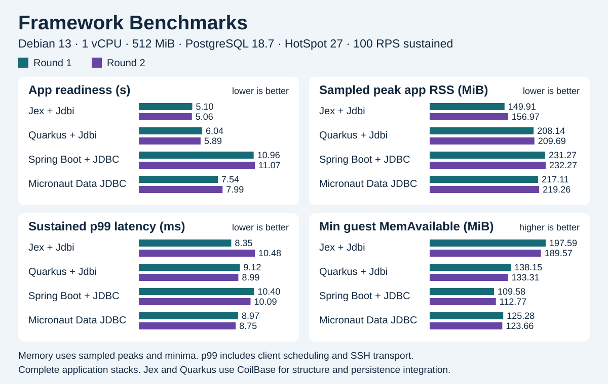

# Framework Benchmarks

Framework Benchmarks is an extensible, cross-language project for comparing
application frameworks under realistic resource constraints. It measures readiness,
memory consumption, throughput, and latency with equivalent applications, shared
workloads, and documented environments. Correctness checks establish comparable
behavior before measurement.

## Reference candidates

- [Jex + Jdbi](framework-benchmarks/jex-coilbase/README.md)
- [Quarkus + Jdbi](framework-benchmarks/quarkus-coilbase/README.md)
- [Spring Boot + JDBC](market-replay-portfolio/app/)
- [Micronaut Data JDBC](framework-benchmarks/micronaut-data-jdbc/README.md)

The implementations use Jex + CoilBase + Jdbi + HikariCP, Quarkus REST +
CoilBase + Jdbi + Agroal, Spring Boot + Spring JDBC + HikariCP, and Micronaut
HTTP + Micronaut Data JDBC + HikariCP. CoilBase provides application structure
and persistence integration for Jex and Quarkus. The benchmark maintainer
is also the CoilBase author. The measurements describe complete application
stacks and do not isolate framework overhead.

[Market Replay Portfolio](market-replay-portfolio/README.md) simulates an
investment portfolio service with portfolio reads and updates, valuations,
and periodic market price ingestion. These operations exercise HTTP, database
access, transactions, and background processing.

All four use the same PostgreSQL schema, correctness contract, and public
synthetic replay. See the [v2 suite guide](framework-benchmarks/suite-v2.md).

## Featured benchmark — v2

The reference comparison ran two rounds on a Debian 13 QEMU/KVM guest on an
AMD Ryzen 7 4700U Linux host. The guest had one vCPU, 512 MiB RAM and no swap.
Each application shared the guest with PostgreSQL 18.7 and used HotSpot 27
(build `27+35-2325`), G1 and `-Xmx80m`. All eight runs sustained 100 RPS
with zero workload errors, timeouts, unsent requests or OOM kills.



| Stack | Round | App readiness (s) | Peak app RSS (MiB) | Sustained p99 (ms) | Min guest MemAvailable (MiB) |
| --- | ---: | ---: | ---: | ---: | ---: |
| Jex + Jdbi | 1 | 5.10 | 149.91 | 8.35 | 197.59 |
| Quarkus + Jdbi | 1 | 6.04 | 208.14 | 9.12 | 138.15 |
| Spring Boot + JDBC | 1 | 10.96 | 231.27 | 10.40 | 109.58 |
| Micronaut Data JDBC | 1 | 7.54 | 217.11 | 8.97 | 125.28 |
| Jex + Jdbi | 2 | 5.06 | 156.97 | 10.48 | 189.57 |
| Quarkus + Jdbi | 2 | 5.89 | 209.69 | 8.99 | 133.31 |
| Spring Boot + JDBC | 2 | 11.07 | 232.27 | 10.09 | 112.77 |
| Micronaut Data JDBC | 2 | 7.99 | 219.26 | 8.75 | 123.66 |

Readiness measures application launch to a successful database-backed check.
The memory figures are sampled sustained-phase extrema. Sustained p99 includes
client scheduling and SSH transport.

| Stack | HTTP framework | Persistence | Connection pool | PostgreSQL JDBC | Artifact manifests |
| --- | --- | --- | --- | --- | --- |
| Jex + Jdbi | Avaje Jex 3.6, Avaje HTTP 3.12.1 | CoilBase Core and Jex adapter 0.1.0-preview5, Jdbi 3.55.0 | HikariCP 7.0.2 | 42.7.8 | [R1](framework-benchmarks/evidence/v2-reference/round-01/jex-coilbase/environment/artifacts.txt), [R2](framework-benchmarks/evidence/v2-reference/round-02/jex-coilbase/environment/artifacts.txt) |
| Quarkus + Jdbi | Quarkus REST 3.40.1 | CoilBase Core 0.1.0-preview5, Jdbi 3.55.0 | Agroal 3.2.1 | 42.7.13 | [R1](framework-benchmarks/evidence/v2-reference/round-01/quarkus-coilbase/environment/artifacts.txt), [R2](framework-benchmarks/evidence/v2-reference/round-02/quarkus-coilbase/environment/artifacts.txt) |
| Spring Boot + JDBC | Spring Boot 4.1.1, Tomcat 11.0.24 | Spring JDBC 7.0.9 | HikariCP 7.0.2 | 42.7.13 | [R1](framework-benchmarks/evidence/v2-reference/round-01/spring-boot/environment/artifacts.txt), [R2](framework-benchmarks/evidence/v2-reference/round-02/spring-boot/environment/artifacts.txt) |
| Micronaut Data JDBC | Micronaut HTTP Server Netty 5.2.11 | Micronaut Data JDBC 5.2.0 | Micronaut JDBC Hikari 7.2.0, HikariCP 7.1.0 | 42.7.13 | [R1](framework-benchmarks/evidence/v2-reference/round-01/micronaut-data-jdbc/environment/artifacts.txt), [R2](framework-benchmarks/evidence/v2-reference/round-02/micronaut-data-jdbc/environment/artifacts.txt) |

### Try your own JVM settings

Fork the repository, customize the JVM settings, and run the same benchmark
protocol. Share your configuration and results in a GitHub issue or pull request.

[Fork this repository](https://github.com/PVRLabs/framework-benchmarks/fork) ·
[Run locally](framework-benchmarks/custom-runs.md#run-locally) ·
[Run with GitHub Actions](framework-benchmarks/custom-runs.md#run-with-github-actions)

### Why CoilBase instead of Hibernate in Quarkus?

Spring Boot + Spring JDBC is the reference implementation. This benchmark
compares lightweight, SQL-first applications with equivalent functionality.
Quarkus REST handles HTTP, Quarkus supplies JDBC connectivity, and Agroal
manages the connection pool. The Quarkus target uses only `coilbase-core`
from CoilBase, with Jdbi for SQL access and explicit transaction management.
Neither `coilbase-jex` nor Avaje Jex is part of this target.

In the earlier [Hibernate isolation experiment](https://pvrlabs.xyz/java-performance/experiments/jpa-memory-experiment-revisited.html),
the same demo app used either Jdbi or direct Hibernate without Spring Data JPA.
Under the mixed workload, the Jdbi implementation used about 55–58 MiB less
process RSS (95.2–96.4 MiB versus 151.8–153.6 MiB). That is an application-level
difference, not an isolated measurement of Hibernate's library overhead. It
motivates keeping Hibernate ORM outside the current SQL-first comparison.

Readers interested in Hibernate or another persistence approach are welcome to
reproduce the benchmark and submit a proposal or PR with supporting measurements.
Additions should answer a specific comparison question.

See the [v2 reference report](framework-benchmarks/evidence/v2-reference/README.md),
[measurements and provenance](framework-benchmarks/evidence/v2-reference/measurements.json),
and [v2 protocol](framework-benchmarks/protocol-v2.md). The original dataset
used external guest CPU samples; it predates the current runner’s phase-boundary
CPU counters. The [published v1 report](framework-benchmarks/evidence/debian-v1/report.html)
and [v1 protocol](framework-benchmarks/protocol-v1.md) remain available; reproduce
v1 with the `benchmark-v1` tagged checkout.

Suite completion and the offline `report` command produce a detailed report and,
for complete measurement suites, a chart beside `suite.json`. Review results
before promotion.

Each target is one evolving implementation. Historical results stay tied to
the exact component versions and configuration used.

### Why AOT is not featured

Featured HotSpot results prioritize conventional deployments, reproducibility
and low maintenance overhead. Framework AOT and JDK AOT caches can deliver
meaningful runtime improvements, as the [PetClinic AOT experiment](https://github.com/ejboy/coilbase-petclinic/blob/main/docs/aot-experiment.md)
shows. They also add build and training workflows, deployment validation and
cache compatibility requirements. We aim to represent practical, maintainable
application deployments, and may evaluate AOT or Native Image separately as
optional optimization studies.

The pre-release runs used historical market prices. The v1 suite uses
synthetic prices with the same symbols, sample count, and replay cadence.
The pre-release archive omits historical prices and derived valuations from the
post-load portfolio snapshots. The accepted performance measurements are
unchanged. The featured Debian results use the public fixture.

The archived evidence retains slot observations, memory samples, pressure
counters, and artifact hashes. Host identifiers and local paths were redacted,
and infrastructure captures unrelated to report regeneration were omitted.

## Building and verifying

Run commands from the checkout root. Build with JDK 25 and Maven 3.9:

```sh
mvn -B -f market-replay-portfolio/app/pom.xml package
mvn -B -f framework-benchmarks/quarkus-coilbase/pom.xml package
mvn -B -f framework-benchmarks/jex-coilbase/pom.xml package
mvn -B -f framework-benchmarks/micronaut-data-jdbc/pom.xml package
python3 -m unittest discover -s framework-benchmarks/tests
```

### Correctness CI

[GitHub Actions](.github/workflows/ci.yml) runs on pushes and pull requests.
It builds all four applications on Ubuntu with Temurin 25.0.4.1 and
Maven 3.9.9, runs the available Java tests, checks the Linux distributions,
runs the shared PostgreSQL verifier for all four candidates, checks the upstream
JVM defaults, and runs the fixture, workload and harness tests.

### VM setup

Use an x86-64 Linux host with working `/dev/kvm`, QEMU, Lima 2.2+, OpenSSH,
Python 3, Bash and standard archive and checksum tools. The pinned official Debian 13 genericcloud image
allocates one vCPU and 512 MiB. Lima verifies the image against the pinned
SHA-512 from the [Debian manifest](https://cloud.debian.org/images/cloud/trixie/20260712-2537/SHA512SUMS).
Setup disables swap, masks scheduled package and firmware maintenance,
installs PostgreSQL 18.7, and verifies the pinned OpenJDK archive.

```sh
tools/vm.sh create fb-debian-v1 framework-benchmarks/vm-linux.yaml
tools/vm.sh start fb-debian-v1
tools/provision-benchmark-storage.sh fb-debian-v1
curl -fL -o fb-jdk.tar.gz https://download.java.net/java/GA/jdk27/55ce5470a6294008af0057ff4626d0e5/35/GPL/openjdk-27_linux-x64_bin.tar.gz
printf '%s  %s\n' 95fc37eb3a18a27a26d5904c2d89d52bace8dafa9a078ca27f4747fbc4bf070b fb-jdk.tar.gz | sha256sum -c -
tools/vm.sh put fb-debian-v1 fb-jdk.tar.gz /var/tmp/fb-jdk.tar.gz
tools/vm.sh put fb-debian-v1 framework-benchmarks/scripts /tmp/fb-setup
tools/vm.sh exec fb-debian-v1 sudo bash /tmp/fb-setup/setup-vm.sh
```

The v1 PostgreSQL profile adapts Theory A from the
[PostgreSQL 18 low-memory experiment](https://pvrlabs.xyz/java-performance/experiments/postgresql-low-memory.html)
to leave more memory for the application sharing the VM. That experiment used
a read-only workload with no colocated application. Here, PostgreSQL allows
10 connections instead of five, including one reserved superuser slot.
See the [v1 PostgreSQL settings](framework-benchmarks/scripts/prepare-postgres.sh).

### PostgreSQL correctness

Use the dedicated disposable database created above. The checks reset its
tables and temporarily change its availability. Start PostgreSQL and leave
the SSH tunnel running in a separate terminal:

```sh
tools/vm.sh exec fb-debian-v1 sudo systemctl start postgresql@18-main
tools/vm.sh tunnel fb-debian-v1 15432 5432
```

Run the checks sequentially, with a new output path each time:

```sh
python3 framework-benchmarks/scripts/verify-postgres.py --vm fb-debian-v1 --output work/spring
python3 framework-benchmarks/scripts/verify-postgres.py --vm fb-debian-v1 --quarkus --output work/quarkus
python3 framework-benchmarks/scripts/verify-postgres.py --vm fb-debian-v1 --jex --output work/jex
python3 framework-benchmarks/scripts/verify-postgres.py --vm fb-debian-v1 --micronaut --output work/micronaut
tools/vm.sh exec fb-debian-v1 sudo systemctl stop postgresql@18-main
```

### Benchmark execution

Use the [v2 suite guide](framework-benchmarks/suite-v2.md) to prepare and run all
four candidates on a dedicated Linux QEMU/KVM host. Keep new work under fresh
paths in `work/`. See [Customize JVM settings](framework-benchmarks/custom-runs.md)
to compare JVM configurations. The pre-release suite and report are archived under
`framework-benchmarks/evidence/v1-accepted/`.

### Regenerate the published v1 report

Use the implementation at the `benchmark-v1` tag to regenerate historical v1
reports. The current runner handles v2 evidence only. The historical
published report and v1 chart remain available in the repository.

## Future comparisons

See the [branch strategy for benchmark experiments](framework-benchmarks/branch-strategy.md)
for how we develop and publish new comparisons. Further framework, runtime and
language comparisons can be developed in experiment branches.
