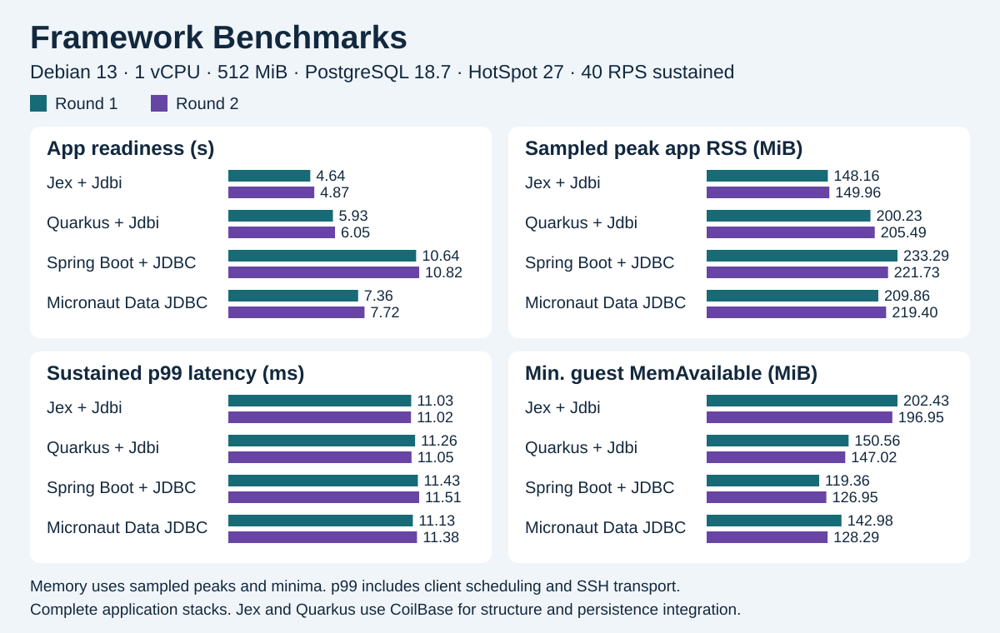

# Benchmark runs and experiments

This page collects reference results, historical comparisons and community
experiments. The [v2 reference benchmark](../README.md#featured-benchmark--v2)
is the current maintained comparison. Runs on different hardware, with different
workloads or with different configurations are not directly comparable.

## Historical reference: v1

The published v1 comparison ran two rounds each of Jex, Quarkus, Spring Boot
and Micronaut on the Lenovo Linux host, using a Debian 13 QEMU/KVM guest with
one vCPU, 512 MiB RAM, no swap and colocated PostgreSQL 18.7. The workload
sustained 40 requests per second with eight workers and eight pending slots.
All eight runs completed without workload errors, timeouts, unsent requests or
OOM kills.

- [Full v1 report](../framework-benchmarks/evidence/debian-v1/report.html)
- [Suite manifest and evidence](../framework-benchmarks/evidence/debian-v1/)
- [V1 protocol](../framework-benchmarks/protocol-v1.md) and [suite guide](../framework-benchmarks/suite-v1.md)
- [Original v1 implementation and configuration at the benchmark-v1 tag](https://github.com/PVRLabs/framework-benchmarks/tree/benchmark-v1)

The current v2 reference uses 100 requests per second and 32 pending slots.
Those changes matter when comparing it with v1. The [v2 reference report](../framework-benchmarks/evidence/v2-reference/README.md)
describes the recorded results and CPU instrumentation.

## Community experiments

Community results are welcome. A contribution can be linked here when it
includes enough information for readers to understand and reproduce the run:

- Contributor, date and the question being investigated.
- Protocol and workload, including any deviations from the reference.
- Host and guest environment, runtime, configuration and application versions.
- A concise result summary, acceptance status and relevant limitations.
- Links to the exact source revision, report and supporting evidence.

Share a proposed experiment in a GitHub issue or pull request. Label it as a
community experiment and keep its results distinct from the maintained
reference; inclusion does not imply that it was independently reproduced or
that its results can be ranked against runs from another environment.
