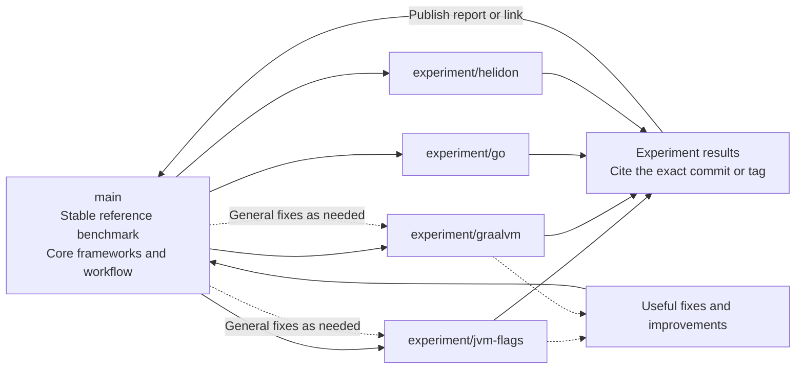

# Branch strategy for benchmark experiments

`main` is the maintained reference benchmark. Start an experiment from it,
then use a branch to answer one question. Framework Benchmarks measures
practical application deployments and keeps its harness focused on those runs.

## Why use branches?

An experiment may need a different build, launch command, VM image, or set of
applications. A branch lets it change just those pieces. Keeping each
experiment's settings and workflow with its code avoids multiplying options
in the reference runner. Readers can understand what `main` runs, and both
the GitHub Actions workflow and local setup remain practical to maintain.

## What belongs on main

Keep the core methodology, workload, correctness contract, workflow, and
maintained set of comparable applications on `main`. The v1 reference covers
Jex, Quarkus, Spring Boot, and Micronaut. Keep accepted measurements tied to
the protocol and revisions that produced them. An official protocol change
gets a new version.

`main` is also the starting point for discovering published comparisons.
Link relevant experiment reports from `main`, even when their implementation
and evidence live on a separate branch.

## What belongs in an experiment branch

Keep the implementation, configuration, and infrastructure for each experiment
on its branch.

Use a branch for JVM tuning, a different JDK build, GraalVM Native Image,
Go or Rust implementations, an alternate framework lineup, or changes to
the VM and operating environment. Choose the candidate set for the question.
For example, a JVM tuning experiment can run just one application with two
JVM configurations. A Helidon comparison can add Helidon and keep one
existing application as a reference.

When a question spans multiple experiments, bring selected implementations
together in a dedicated comparison branch. They can share a workload and
environment there while remaining separate from the maintained set on `main`.
An experiment can also grow into a broader comparison or serve as the starting
point for a follow-up. For example, a Go experiment could evolve into a
multi-language comparison.

Keep at least one unchanged reference target when possible. Run it alongside
the variant in the experiment environment to give the results context.
Record any differences in workload, hardware, or software that matter to
the comparison.

## What comes back to main

Bring back bug fixes, important harness or workflow improvements, and clearer
documentation in focused changes. Keep general fixes on `main` and propagate
them to active experiment branches as needed. Promote a widely adopted target when it
adds lasting value to the reference comparison and the project can maintain
its application code, correctness checks, and runner support.

Publish relevant results or links to them on `main`. Cite the exact commit SHA
or a tag that identifies that commit, and link the configuration, environment,
reports, and evidence. Publishing a comparison leaves the experimental
implementation on its branch and carries no commitment to maintain it as a
core target. Promotion is a separate maintenance decision.

## How changes flow

## Practical workflow

1. Start from `main` and create a branch for one question.
2. Choose the candidates and an unchanged reference where possible. Adapt
   the build, workflow, or VM setup only where the experiment needs it.
3. Run correctness and preparation checks, then measure locally or in GitHub
   Actions. Use the [custom runs guide](custom-runs.md) for JVM experiments.
4. Publish or link relevant results from `main`. Include their limitations,
   the experiment commit or tag, and the evidence needed to reproduce them.
5. Open a focused pull request for improvements that belong on `main`.
